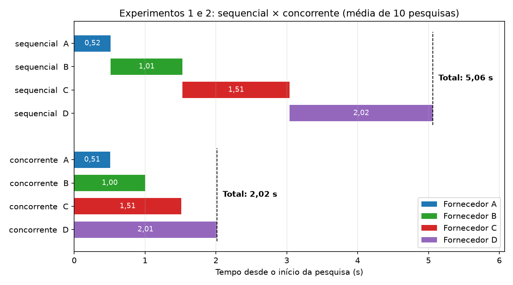
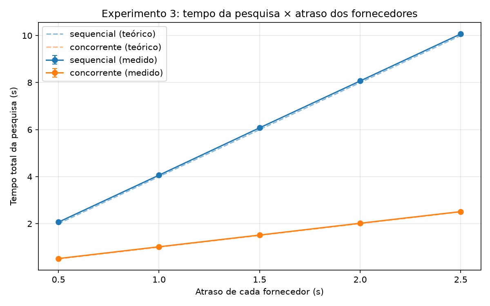
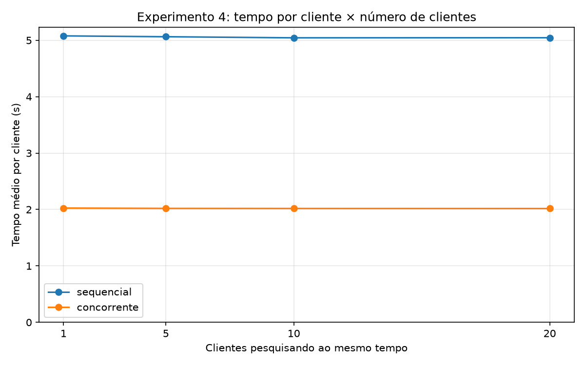
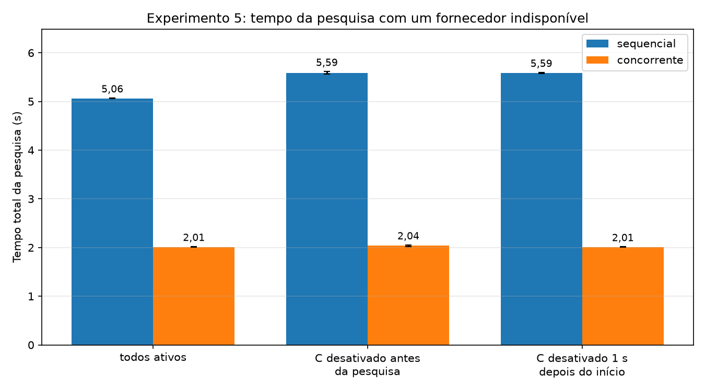

# Comparador de Hospedagens

Trabalho 1 de Sistemas Distribuídos (UNIFESSPA, FACSI), Tema 4: Comparador de Hospedagens.

Aplicação cliente-servidor em Python que pesquisa hospedagens em quatro fornecedores independentes, usando sockets TCP. O agregador consulta os fornecedores de duas formas: um de cada vez (sequencial) e todos ao mesmo tempo, com threads (concorrente). O projeto compara o tempo das duas formas. Os dados de hospedagem são simulados.

## O que o trabalho pede e onde está cada parte

Entregáveis do enunciado:

| Entregável | Onde está |
|---|---|
| Documento de requisitos | `docs/requisitos/` |
| Modelagem (casos de uso, arquitetura e sequência) | `docs/modelagem/` |
| Código-fonte e instruções de execução | este repositório e este README |
| Experimentos e resultados | `experimentos/` (tabelas e gráficos em `experimentos/resultados/`) |
| Relatório técnico e apresentação | não fazem parte do repositório |

Requisitos técnicos do enunciado:

| Requisito | Onde está |
|---|---|
| Sockets TCP entre os componentes | os três programas usam o módulo `socket` |
| Pelo menos quatro serviços independentes | fornecedores A, B, C e D, cada um em um processo com porta própria (`fornecedores/fornecedor.py`) |
| Consultas sequenciais | `consultar_sequencial` em `agregador/agregador.py` |
| Consultas concorrentes com threads | `consultar_concorrente` em `agregador/agregador.py` |
| Atendimento de vários clientes | uma thread por conexão no agregador (`main` e `atender`) |
| Protocolo de aplicação documentado | `docs/protocolo/protocolo.md` |
| Tratamento de erros e desconexões | validação, tempo limite e isolamento de fornecedores com falha no agregador; conferido por `testes/teste_sistema.py` |
| Registro do tempo de execução | `registrar_tempos` em `agregador/agregador.py`, que grava `agregador/registro_tempos.csv` |
| Consolidar e apresentar os resultados | `consolidar` (agregador) e `mostrar_resultado` (cliente) |
| Demonstração | roteiro manual, mais abaixo |
| Cinco experimentos obrigatórios | `experimentos/` |

## Como funciona

```
Cliente(s) --TCP/JSON--> Agregador --TCP/JSON--> Fornecedor A (porta 5001)
                                             --> Fornecedor B (porta 5002)
                                             --> Fornecedor C (porta 5003)
                                             --> Fornecedor D (porta 5004)
```

- O **cliente** (terminal) pede destino, datas, número de hóspedes e o modo da consulta.
- O **agregador** (porta 5000) recebe a pesquisa, consulta os fornecedores, junta os resultados e responde ao cliente.
- Cada **fornecedor** é um processo independente, com sua porta, sua base de hospedagens e um atraso configurável que simula a demora de uma consulta real.

### Uma pesquisa, passo a passo

1. O usuário informa destino, check-in, check-out, número de hóspedes e o modo (sequencial ou concorrente) no cliente.
2. O cliente envia ao agregador a mensagem `pesquisar`.
3. O agregador valida o pedido. Se algo estiver errado, responde com um erro.
4. O agregador consulta os quatro fornecedores. No modo sequencial, um depois do outro. No modo concorrente, uma thread por fornecedor, todos ao mesmo tempo.
5. Cada fornecedor valida o pedido, espera o seu atraso, procura as hospedagens do destino, calcula o preço total (diária vezes o número de noites) e responde.
6. O agregador junta as hospedagens, ordena pelo preço total (em empate, mais estrelas primeiro), aponta a mais econômica, mede o tempo, grava uma linha no registro de tempos e responde ao cliente.
7. O cliente mostra a tabela de hospedagens, avisa quais fornecedores ficaram indisponíveis e mostra os tempos.

### Sequencial e concorrente

Com os fornecedores respondendo em 0,5, 1, 1,5 e 2 segundos:

- **Sequencial:** o agregador pergunta ao A, espera, pergunta ao B, espera, e assim por diante. O tempo total é a **soma**: cerca de 5 segundos.
- **Concorrente:** o agregador cria uma thread para cada fornecedor e pergunta a todos ao mesmo tempo. O tempo total é o do **mais lento**: cerca de 2 segundos.

Isso funciona porque o agregador passa quase todo o tempo esperando a resposta da rede, e as esperas acontecem em paralelo.

### Quando um fornecedor falha

A pesquisa continua com os outros. O fornecedor com problema aparece como `indisponível` (não respondeu ou recusou a conexão, com tempo limite de 3 segundos) ou como `erro` (respondeu fora do formato do protocolo). Só se **todos** falharem o agregador devolve um erro.

## O protocolo em resumo

As mensagens são JSON em uma única linha terminada por `\n`. Cada pedido usa uma conexão nova: quem pede conecta, envia uma mensagem, recebe uma resposta e fecha. Datas no formato `DD/MM/AAAA`; valores com ponto decimal dentro das mensagens (o cliente mostra com vírgula).

Pedido do cliente ao agregador:

```json
{"operacao": "pesquisar", "destino": "Rio de Janeiro", "checkin": "10/12/2026",
 "checkout": "15/12/2026", "hospedes": 2, "modo": "concorrente"}
```

Resposta (resumida):

```json
{"status": "sucesso", "modo": "concorrente", "tempo_total_ms": 2004,
 "resultados": [{"fonte": "Fornecedor C", "nome": "Hostel Lapa", "tipo": "hostel", "estrelas": 2,
                 "preco_diaria": 120.0, "preco_total": 600.0}, "..."],
 "mais_economica": {"fonte": "Fornecedor C", "nome": "Hostel Lapa", "preco_total": 600.0},
 "fornecedores": [{"fonte": "Fornecedor A", "status": "sucesso", "quantidade": 2, "tempo_ms": 502}, "..."]}
```

O agregador pergunta aos fornecedores com a operação `consultar`. Os formatos completos, os erros e o encerramento das conexões estão em `docs/protocolo/protocolo.md`.

## Estrutura do projeto

```
agregador/
    agregador.py            agregador (porta 5000)
cliente/
    cliente.py              cliente de terminal
fornecedores/
    fornecedor.py           fornecedor (usado 4 vezes, com letra e porta diferentes)
    dados_fornecedores.py   hospedagens simuladas dos fornecedores A, B, C e D
experimentos/
    experimentos.py         experimentos 1 a 5 (gera as tabelas)
    graficos.py             gráficos a partir das tabelas
    resultados/             tabelas (.csv e .md) e gráficos (.png) gerados
testes/
    teste_sistema.py        teste automático do sistema
docs/
    requisitos/             documento de requisitos
    protocolo/              protocolo de comunicação
    modelagem/              diagramas (casos de uso, arquitetura e sequência)
iniciar_fornecedores.bat    abre os 4 fornecedores (Windows)
```

### O que cada programa faz por dentro

| Arquivo | Responsabilidade | Funções principais |
|---|---|---|
| `fornecedores/fornecedor.py` | Servidor que atende uma consulta por conexão | `montar_resposta` (valida, espera o atraso, busca e calcula), `normalizar` (ignora acentos e maiúsculas no destino), `ler_linha`, `atender`, `main` |
| `agregador/agregador.py` | Recebe a pesquisa, consulta os fornecedores e consolida | `validar_pesquisa`, `consultar_fornecedor`, `consultar_sequencial`, `consultar_concorrente`, `hospedagens_validas`, `consolidar`, `registrar_tempos`, `processar`, `atender`, `main` |
| `cliente/cliente.py` | Interface de terminal | `montar_pedido` e as funções `perguntar_...`, `enviar_pesquisa`, `mostrar_resultado`, `mostrar_detalhes`, `menu_final` |
| `experimentos/experimentos.py` | Abre os programas, mede e grava as tabelas | `configurar`, `pesquisar`, `experimento_1_2`, `experimento_3`, `experimento_4`, `experimento_5` |
| `experimentos/graficos.py` | Desenha os gráficos a partir das tabelas | `grafico_comparacao`, `grafico_latencia`, `grafico_clientes`, `grafico_falhas` |
| `testes/teste_sistema.py` | Teste automático de integração | `testar_fornecedor`, `testar_agregador`, `testar_falhas` |

## Decisões de projeto

- **Fornecedores como processos independentes, na mesma máquina, cada um em uma porta.** O enunciado pede serviços independentes e permite portas distintas na mesma máquina. A comunicação é por sockets TCP reais, mesmo em `127.0.0.1`. Os endereços dos fornecedores ficam numa lista no agregador. Para usar outras máquinas seria preciso trocar esses endereços, fazer os fornecedores escutarem em um endereço acessível pela rede (`HOST` em `fornecedor.py`, hoje `127.0.0.1`) e liberar as portas no firewall. Isso não foi testado.
- **Uma conexão por pedido.** É mais simples, e cada pesquisa é independente das outras.
- **Uma thread por conexão, no agregador e nos fornecedores.** Assim vários clientes são atendidos ao mesmo tempo. Sem isso, os atrasos de pedidos simultâneos se somariam.
- **Falha isolada.** Um fornecedor fora do ar, lento ou com resposta quebrada não derruba a pesquisa: só ele é marcado como indisponível ou com erro.
- **Tempo limite de 3 segundos por fornecedor.** Evita que um fornecedor lento trave a pesquisa.
- **Ordem estável dos resultados.** No modo concorrente, cada resposta é guardada na posição do seu fornecedor, então o resultado não depende de quem respondeu primeiro. O desempate por estrelas existe pelo mesmo motivo.
- **Validação nas duas pontas.** O agregador valida o pedido do cliente e confere o formato da resposta dos fornecedores. Cada fornecedor valida o pedido do agregador.
- **Registro em CSV com `;`**, para abrir direto no Excel em português.

## Resultados dos experimentos

Resumo da execução completa que está em `experimentos/resultados/` (detalhes em `resultados.md`):

| Experimento | O que os números mostram |
|---|---|
| 1 e 2 | Sequencial: 5,06 s. Concorrente: 2,02 s. O concorrente foi 2,51 vezes mais rápido |
| 3 | O sequencial cresce em 4 vezes o atraso dos fornecedores, e o concorrente em 1 vez, sempre próximo do valor teórico (com 2 s de atraso: 8,07 s e 2,02 s) |
| 4 | De 1 a 20 clientes ao mesmo tempo, o tempo por cliente não piorou em nenhum dos modos, e não houve falhas |
| 5 | Com o fornecedor C desligado, a pesquisa continua, e a mais econômica deixa de ser o Hostel Lapa (R$ 600,00) e passa a ser o Hotel Sol (R$ 1.100,00). Uma falha muda o resultado, e não só o tempo |









## Obter o código

```
git clone https://github.com/Paulomlr/comparador-hospedagens.git
cd comparador-hospedagens
```

## Requisitos para executar

- Python 3 (testado com Python 3.15.2 no Windows 11; não foi testado em outras versões).
- O sistema usa apenas a biblioteca padrão do Python.
- Só os gráficos precisam do matplotlib: `python -m pip install matplotlib`.

## Como executar

Rode cada programa em um terminal diferente, sempre na pasta do projeto. Digite os comandos no terminal; não use o botão de executar do VS Code para o segundo programa em diante, porque ele interrompe o programa que já estava rodando no mesmo terminal.

**1. Fornecedores.** No Windows, dê dois cliques em `iniciar_fornecedores.bat` (ou rode `iniciar_fornecedores.bat` no terminal). Ele abre 4 janelas. Também dá para abrir cada um à mão, em 4 terminais (o último número é o atraso em segundos):

```
python fornecedores\fornecedor.py A 5001 0.5
python fornecedores\fornecedor.py B 5002 1
python fornecedores\fornecedor.py C 5003 1.5
python fornecedores\fornecedor.py D 5004 2
```

**2. Agregador:**

```
python agregador\agregador.py
```

**3. Cliente:**

```
python cliente\cliente.py
```

No Linux ou macOS, troque `\` por `/` nos caminhos e abra os fornecedores à mão.

Para encerrar qualquer programa, use `Ctrl+C` no terminal dele (ou feche a janela, no caso dos fornecedores).

| Programa | Porta |
|---|---|
| Agregador | 5000 |
| Fornecedor A | 5001 |
| Fornecedor B | 5002 |
| Fornecedor C | 5003 |
| Fornecedor D | 5004 |

## Como testar

### 1. Teste automático

Com todos os programas fechados, rode na pasta do projeto:

```
python testes\teste_sistema.py
```

O teste abre os fornecedores e o agregador sozinho, leva cerca de 30 segundos e mostra `OK` ou `FALHA` para cada verificação. Ele confere:

- o protocolo do fornecedor (resposta de sucesso, destino inexistente, pedidos inválidos);
- as pesquisas do agregador nos dois modos (ordenação, mais econômica, mesmos resultados, tempo sequencial próximo da soma e concorrente próximo do maior);
- os pedidos inválidos recusados pelo agregador;
- cinco clientes ao mesmo tempo e cliente que desconecta no meio;
- falhas: fornecedor desligado, fornecedor que responde lixo ou dados incompletos, todos desligados;
- o arquivo de registro de tempos.

Ao final aparece `TODAS AS VERIFICAÇÕES PASSARAM.` ou o número de falhas.

### 2. Roteiro manual (serve também para a demonstração)

Suba os fornecedores, o agregador e o cliente, como na seção anterior.

1. **Modo concorrente.** Pesquise Rio de Janeiro, check-in 10/12/2026, check-out 15/12/2026, 2 hóspedes, modo 2. O tempo deve ficar perto de 2 s (o fornecedor mais lento tem 2 s) e a mais econômica deve ser o Hostel Lapa, R$ 600,00.
2. **Modo sequencial.** Repita com o modo 1. O tempo deve ficar perto de 5 s (0,5 + 1 + 1,5 + 2) e os resultados são os mesmos.
3. **Dados inválidos.** Digite uma data como 31/02/2026, um check-out antes do check-in ou 0 hóspedes. O cliente avisa e pergunta de novo.
4. **Fornecedor fora do ar.** Feche a janela do fornecedor C e pesquise de novo. A tela mostra `Fornecedor C: indisponível`, a pesquisa continua com os outros três e a mais econômica passa a ser o Hotel Sol, R$ 1.100,00.
5. **Vários clientes.** Abra dois ou três terminais com o cliente e pesquise ao mesmo tempo no modo 2. Todos devem responder em cerca de 2 s.
6. **Agregador desligado.** Feche o agregador e pesquise. O cliente avisa que não conseguiu conectar.
7. **Registro de tempos.** Abra `agregador/registro_tempos.csv` (por exemplo no Excel). Há uma linha por pesquisa, com o modo, o tempo total e o tempo de cada fornecedor.

### 3. Experimentos

Com todos os programas fechados:

```
python experimentos\experimentos.py
python experimentos\graficos.py
```

O primeiro leva cerca de 10 minutos. Ele abre os fornecedores e o agregador sozinho, executa os experimentos 1 a 5 do enunciado com várias repetições e grava as tabelas em `experimentos/resultados/` (`resultados.md` reúne todas). O segundo gera os quatro gráficos (PNG) na mesma pasta e precisa do matplotlib. Durante a execução, evite usar o computador para outras tarefas pesadas, para não alterar os tempos medidos.

**O que cada experimento faz.** Em todos, a pesquisa é Rio de Janeiro, de 10/12/2026 a 15/12/2026, com 2 hóspedes, e antes de cada série há uma pesquisa de aquecimento, descartada. Os fornecedores A, B, C e D têm atrasos de 0,5, 1, 1,5 e 2 s, exceto quando o experimento diz outra coisa.

| Experimento | O que o script faz | Repetições | Arquivos | Gráfico |
|---|---|---|---|---|
| 1 e 2: consulta sequencial e concorrente | Pesquisa nos dois modos e compara os tempos totais. O gráfico mostra, em linha do tempo, quando cada fornecedor foi consultado em cada modo | 10 por modo | `exp1_2_*.csv` | `grafico_4_comparacao.png` |
| 3: simulação de latência | Põe o mesmo atraso nos quatro fornecedores (0,5, 1, 1,5, 2 e 2,5 s) e mede os dois modos. Compara com o valor teórico (4 x atraso no sequencial, 1 x no concorrente) | 5 por atraso e modo | `exp3_*.csv` | `grafico_1_latencia.png` |
| 4: vários clientes | Dispara 1, 5, 10 e 20 clientes ao mesmo tempo, nos dois modos, e mede o tempo de cada cliente | 3 por quantidade e modo | `exp4_*.csv` | `grafico_2_clientes.png` |
| 5: indisponibilidade | Pesquisa com todos ativos, com o fornecedor C desligado antes da pesquisa e com o C desligado 1 s depois do início dela. Registra o estado do C, quantas hospedagens vieram e qual foi a mais econômica | 5 por cenário e modo | `exp5_*.csv` | `grafico_3_falhas.png` |

**Os arquivos.** Cada experimento gera dois CSV: `_repeticoes` (uma linha por pesquisa feita) e `_resumo` (média, desvio padrão, mínimo e máximo, em milissegundos). O `resultados.md` junta os resumos de todos. O `registro_tempos_experimentos.csv` é o registro que o próprio agregador gravou durante a execução, com uma linha por pesquisa.

**Quando rodar de novo.** Os números do repositório vêm da última execução completa. Se o código do agregador (`agregador.py`), do fornecedor (`fornecedor.py`) ou os dados dos fornecedores mudarem, rode os dois comandos de novo, para atualizar as tabelas e os gráficos, e confira se o texto do relatório e dos slides ainda bate com os números. Alterações só na documentação não precisam disso.

**Atenção ao modo rápido.** `python experimentos\experimentos.py --rapido` serve só para testar o script (poucas repetições, cerca de 2 minutos) e **sobrescreve** as tabelas na pasta `resultados`. Para voltar aos resultados completos que estão no repositório, use `git restore experimentos/resultados`.

## Configurações

- **Atraso de um fornecedor:** terceiro argumento do `fornecedor.py`, em segundos (entre 0 e 60).
- **Tempo limite do agregador:** `TIMEOUT` em `agregador/agregador.py` (3 segundos por fornecedor).
- **Endereços dos fornecedores:** lista `FORNECEDORES` em `agregador/agregador.py`.
- **Hospedagens simuladas:** `fornecedores/dados_fornecedores.py`.
- **Registro de tempos:** `agregador/registro_tempos.csv`, separado por `;`, com as colunas `data_hora`, `modo`, `destino`, `tempo_total_ms`, `tempo_A_ms` a `tempo_D_ms` e `fornecedores_ok`.

## Onde alterar

| Para mudar | Onde |
|---|---|
| Hotéis e preços | `fornecedores/dados_fornecedores.py` |
| Porta ou atraso de um fornecedor | argumentos do `fornecedor.py` (e linhas do `iniciar_fornecedores.bat`) |
| Tempo limite por fornecedor | `TIMEOUT` em `agregador/agregador.py` |
| Regra de ordenação ou da opção mais econômica | função `consolidar` em `agregador/agregador.py` |
| Validação do pedido | `validar_pesquisa` em `agregador/agregador.py` e `montar_resposta` em `fornecedores/fornecedor.py` |
| Nova forma de consultar os fornecedores | nova função `consultar_...` registrada em `ESTRATEGIAS` no agregador (e o modo aceito em `validar_pesquisa` e no menu do cliente) |
| O que aparece na tela do cliente | `mostrar_resultado` e `mostrar_detalhes` em `cliente/cliente.py` |
| Formato das mensagens | `docs/protocolo/protocolo.md` e os três programas |

Para acrescentar um quinto fornecedor, são necessários: seus dados em `dados_fornecedores.py`, uma linha na lista `FORNECEDORES` do agregador e a mensagem de letra válida do `fornecedor.py` (hoje cita A a D). O teste automático e os experimentos assumem exatamente quatro fornecedores (A a D) e também precisam de ajuste.

## Como contribuir

1. Crie uma branch para a alteração.
2. Rode `python testes\teste_sistema.py` antes de enviar. Se mexer no agregador ou no fornecedor, rode também os experimentos de novo, porque as tabelas e os gráficos dependem do código.
3. Se a alteração mudar o comportamento, atualize o README e, quando for o caso, o protocolo (`docs/protocolo/`) e os requisitos (`docs/requisitos/`).
4. Não envie o arquivo `agregador/registro_tempos.csv` (ele é gerado ao usar o sistema e já está no `.gitignore`).
5. Abra um pull request ou avise o grupo.

## Limitações e observações

- Um fornecedor com atraso de 3 s ou mais é considerado indisponível pelo agregador (tempo limite). Nos experimentos, os atrasos ficam abaixo disso.
- O tempo limite de 3 s vale para cada operação de rede (conectar, ler a resposta) e não para o total da consulta a um fornecedor.
- No Windows, tentar conectar a um fornecedor desligado leva cerca de 2 s para falhar. Esse tempo aparece nas medições.
- O número de hóspedes é validado e enviado aos fornecedores, mas na simulação não altera o preço.
- Os destinos disponíveis na base simulada são Rio de Janeiro, São Paulo, Belém e Marabá. Outro destino devolve uma lista vazia.
- Não há limite para o tamanho de uma mensagem recebida.
- Se um cliente desconectar durante a pesquisa, o agregador termina a pesquisa, registra os tempos e descarta a resposta.
- Tudo foi testado em uma única máquina (Windows 11, Python 3.15.2), com os componentes em `127.0.0.1`.

## Glossário

- **Socket:** ponta de uma comunicação entre dois programas pela rede.
- **TCP:** protocolo que entrega as mensagens inteiras e na ordem, como uma ligação telefônica.
- **Porta:** número que identifica qual programa recebe a comunicação em uma máquina.
- **Processo:** programa em execução, com sua própria memória. Os fornecedores, o agregador e o cliente são processos separados.
- **Thread:** linha de execução dentro de um processo. Com threads, várias esperas acontecem ao mesmo tempo.
- **Sequencial:** consultar um fornecedor depois do outro.
- **Concorrente:** consultar todos os fornecedores ao mesmo tempo, com uma thread para cada um.
- **Tempo limite (timeout):** tempo máximo de espera por uma resposta antes de desistir.
- **Protocolo de aplicação:** combinação do formato e da ordem das mensagens entre os programas.

## Documentos

- Requisitos: `docs/requisitos/requisitos.md`
- Protocolo de comunicação: `docs/protocolo/protocolo.md`
- Diagramas: `docs/modelagem/`

## Possíveis evoluções

Ideias para trabalhos futuros, que não fazem parte desta entrega: interface gráfica ou web para o cliente, cache dos resultados e adaptadores para fornecedores com formatos de mensagem diferentes.
